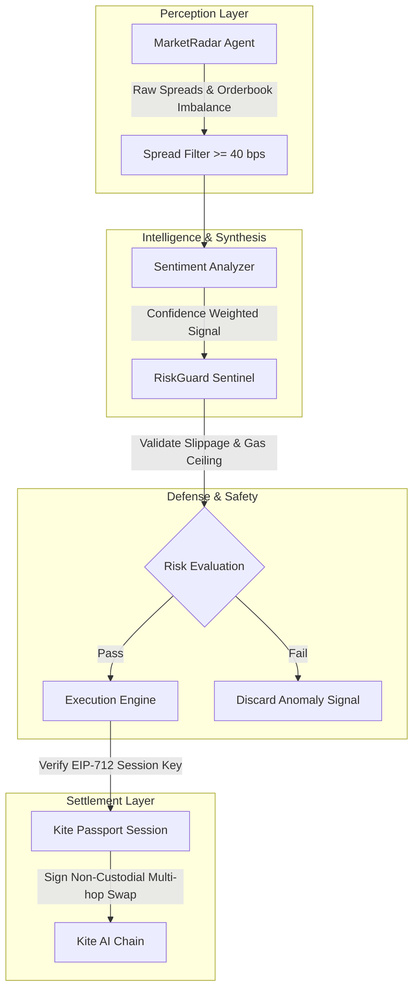

# Kite AI Autonomous Agent Pipeline Architecture

## 1. Design Philosophy

The Kite AI Autonomous Trading & Research Console operates on a strict separation of concerns among specialized agents. Unlike monolithic trading bots, our architecture decouples perception, macro/ecosystem synthesis, defensive risk control, and transaction settlement into discrete agents.



## 2. Agent Specifications

### 2.1 MarketRadar Agent (`MarketRadar`)
- **Sampling Frequency**: Polling every 3000ms.
- **Pairs Monitored**: `KITE/USDT`, `ETH/USDC`, `WBTC/KITE`, `pieUSD/USDC`.
- **DEX Integrations**: KiteSwap v2, Camelot DEX, Uniswap v3 bridge pool.
- **Mathematical Threshold**:
  $$\text{Spread (bps)} = \left| \frac{P_{DEX_B} - P_{DEX_A}}{P_{DEX_A}} \right| \times 10,000$$
  Opportunities with $\text{Spread} \ge 40\text{ bps}$ and $\text{Net Yield} > \$2.00$ are forwarded.

### 2.2 SentimentAnalyzer Agent (`SentimentAnalyzer`)
- Synthesizes GitHub commit frequency across the Kite AI ecosystem, grants distribution telemetry, and on-chain whale flow momentum.
- Emits confidence score between 0.0 and 1.0. Minimum confidence required for execution is 0.60.

### 2.3 RiskGuard Sentinel (`RiskGuard`)
- Evaluates pool manipulation anomalies (rejects $\text{Spread} > 500\text{ bps}$ as low-liquidity or oracle attacks).
- Enforces maximum slippage bounds (default 50 bps).
- Verifies maximum daily drawdown limits (default \$500 USD).

### 2.4 ExecutionEngine (`ExecutionEngine`)
- Validates active Kite Passport delegated session key.
- Guarantees non-custodial safety: agent cannot exceed session daily budget or access user funds outside designated router contracts.

---

## 3. Kite Passport EIP-712 Session Security

The session delegation utilizes the standard EIP-712 typed signing schema:

```typescript
const PASSPORT_DOMAIN = {
  name: 'KitePassportSessionDelegation',
  version: '1',
  chainId: 2368,
  verifyingContract: '0x2E234DAe75C793f67A35089C9d99245E1C58470b',
};
```

Delegators configure `validUntil` timestamps and `maxDailyBudgetUsd`. Private keys never leave user devices.
